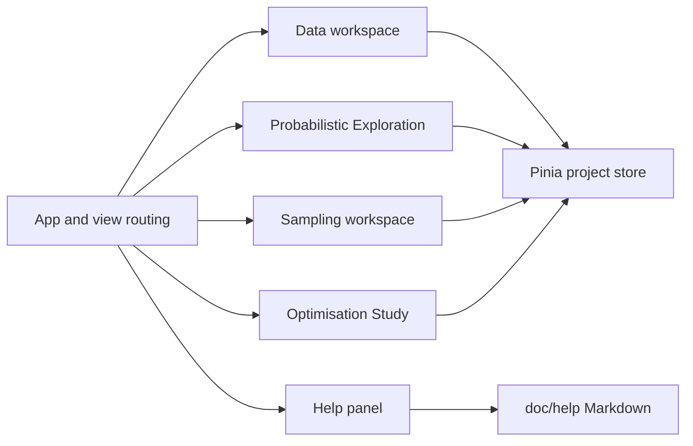
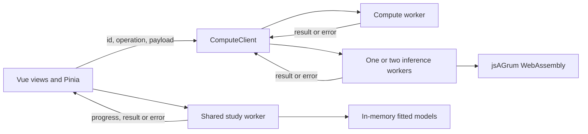

# Architecture and project format

[Documentation index](README.md)

## Source map

| Responsibility                                               | Source                                                                                                                                                     |
| ------------------------------------------------------------ | ---------------------------------------------------------------------------------------------------------------------------------------------------------- |
| Entry and workspace routing                                  | [main.ts](../src/main.ts), [App.vue](../src/App.vue)                                                                                                       |
| Shared editor state, revisions, job and download preparation | [store.ts](../src/store.ts)                                                                                                                                |
| Project, dataset, variable, evidence, and CPT schemas        | [domain.ts](../src/domain.ts)                                                                                                                              |
| CSV, bins, and CPT counts                                    | [processing.ts](../src/processing.ts)                                                                                                                      |
| Generated columns and formula evaluation                     | [data-columns.ts](../src/data-columns.ts), [formula.ts](../src/formula.ts)                                                                                 |
| Network inference and main worker protocol                   | [engine.ts](../src/engine.ts), [compute.worker.ts](../src/compute.worker.ts), [client.ts](../src/client.ts)                                                |
| Query and graph rendering                                    | [InferenceWorkspace.vue](../src/InferenceWorkspace.vue), [QueryResults.vue](../src/QueryResults.vue), [ProbabilityGraph.vue](../src/ProbabilityGraph.vue)  |
| SVG/PNG figures and network export                           | [query-figure.ts](../src/query-figure.ts), [graph-export.ts](../src/graph-export.ts), [files.ts](../src/files.ts)                                          |
| Posterior sampling                                           | [SamplingWorkspace.vue](../src/SamplingWorkspace.vue), [SampleExport.vue](../src/SampleExport.vue), [sampling.ts](../src/sampling.ts)                      |
| Study, surrogate fitting, and search                         | [study.ts](../src/study.ts), [study-model.ts](../src/study-model.ts), [study-search.ts](../src/study-search.ts), [study.worker.ts](../src/study.worker.ts) |

## Computation

The regular compute worker handles CSV parsing, column generation, configuration, preview, training, layout, and exports. Each query runner sends a snapshot with its own evidence and targets. A worker handles one request at a time. The query pool uses distinct clients to avoid shared inference state. Requests use numeric IDs so late messages do not resolve a newer request. A timeout or cancellation terminates the worker. The study client uses a longer timeout for model fitting and search.

## File format

Project downloads are UTF-8 JSON with a 100 MiB limit. `schemaVersion` is 5. The [Zod schemas](../src/domain.ts) are the authoritative field reference.

| Field                                        | Meaning                                                                                                                                         |
| -------------------------------------------- | ----------------------------------------------------------------------------------------------------------------------------------------------- |
| `id`, `name`, timestamps, `example`          | Project identity, title, and optional tutorial provenance                                                                                       |
| `dataset`, `missingTokens`                   | CSV descriptor, SHA-256, header order, delimiter, row count, optional source text, and the configured missing-value tokens                      |
| `variables`, `edges`                         | UUID-addressed nodes and directed parent–child links. Display labels and coordinates are separate from state identities                         |
| `cpts`                                       | Parent order, flattened probabilities and counts, training signature, estimator, smoothing, dataset hash, and training time                     |
| `queryGroups`                                | Stable IDs, editable names, ordered target IDs, and each query’s evidence map                                                                   |
| `savedResults`                               | Array of completed entries keyed by query ID. Each has a SHA-256 fingerprint of inference inputs, a query key, node marginals, and joint arrays |
| `study`                                      | Frozen query snapshot, posterior grid, coverage, explicit constraint definitions, node roles and estimators, and holdout settings               |
| `probabilityDecimalPlaces`, `heatmapPalette` | Optional presentation settings. Defaults are 3 decimal places and Blues                                                                         |

Column IDs use zero-based source positions prefixed with `c`. Manual nodes have an empty column ID. State assignments are zero-based indices into the variable’s state list. Numeric bin bounds are stored alongside fitted ranges, cuts, and boundary choices. In legacy projects an absent bounds object represents open-ended outer bins. Versions 1 and 2 first pass through the legacy converters, then migrate to version 5. Versions 3 and 4 upgrade directly, preserving trained CPTs and state indices. Studies migrate single-node limits to explicit definitions. Older app versions reject version 5 saves.

The result fingerprint covers missing tokens, numeric encoding, topology, and trained CPTs and their source hashes. The query key covers ordered targets and evidence sorted by variable ID. The result cache checks that key and the model fingerprint before restoring a saved entry. Presentation changes and query names are independent of inference. The CSV may be reattached by matching its hash. The saved CPTs and completed query results support exploration while the CSV is detached. Fitted surrogate forests live in memory.
