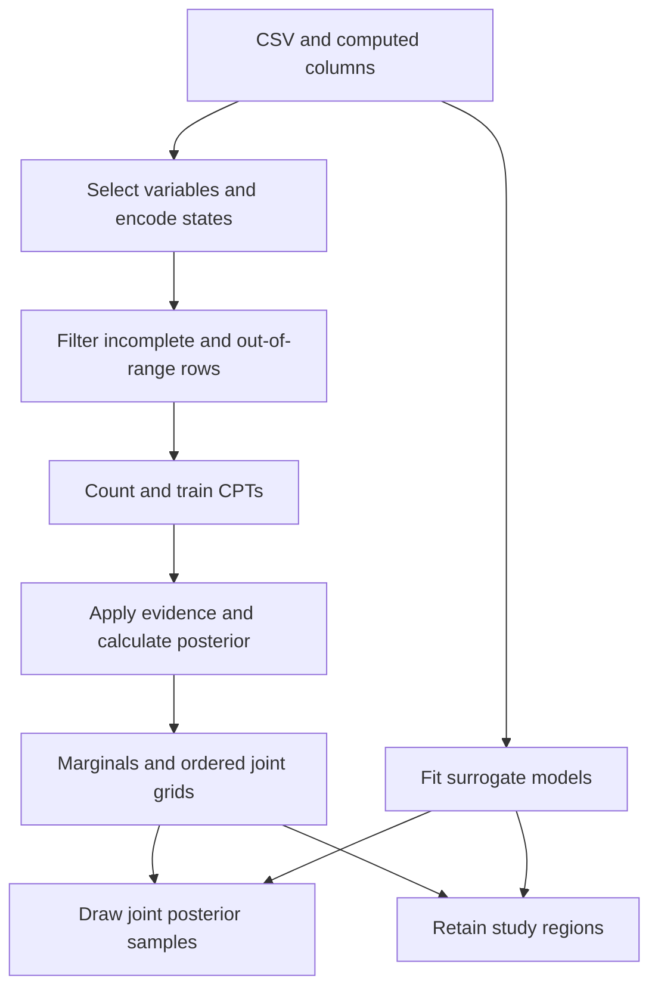

# Bayesian network methods

[Documentation index](README.md)

## CSV and variable encoding

The CSV parser supports quoted fields, a UTF-8 BOM and explicit or detected delimiters. Headers must be unique and nonblank. The source hash identifies the exact text used for a saved dataset. A row can be missing for one variable and usable for another analysis. Network training excludes rows with missing data in any selected CSV-backed variable. The initial missing token is an empty field. Other strings are valid categories unless configured as missing.

A categorical state is a distinct source string. A finite numeric state is a distinct finite number sorted numerically. A discretised variable maps a number to the count of internal cuts at or below it. State display labels and decimal places affect presentation.

For equal-width bins, the span is split into equal intervals. Finite configured endpoints determine the corresponding ends of the span. On an unbounded side the observed extreme supplies the end for fitting. Quantile cuts use linear interpolation between adjacent sorted in-range samples at fractional rank `(n−1)k/B` for cut `k` of `B` bins. Repeated cuts collapse. Manual cuts are entered explicitly. New limits default to the observed finite extrema and the fitted numbers are stored. A cut is included in the bin on its right. The finite maximum is included in the last bin, so a cut at that endpoint can create a singleton. For cuts 10 and 20 and bounds 0 and 30, the states are `[0,10)`, `[10,20)` and `[20,30]`. Numeric observations outside finite limits are excluded from training and rejected as evidence.

## Training and exact inference

The graph factorises the joint distribution as `P(x) = Πᵢ P(xᵢ | parentsᵢ)`. For every parent assignment, count each child state. Maximum likelihood estimates `pₖ = nₖ / Σⱼ nⱼ`. Dirichlet smoothing uses `pₖ = (nₖ + α) / (Σⱼ nⱼ + Kα)` for a child with `K` states. For counts 3 and 1, maximum likelihood gives 0.75 and 0.25. With α = 1, smoothing gives 4/6 and 2/6. A uniform CPT assigns `1/K` per cell in each parent row. Maximum likelihood needs observations for each learned row. The training UI reports complete-case counts and cycles block training and inference.

Evidence can select one state, unite several states of one variable, or apply a numeric threshold. Separate variable predicates combine by intersection. A discretised inequality must resolve to a union of complete bins. Strict greater-than and inclusive less-than advance to the next representable floating-point number where needed. Boundary cases that cover all or none of the support are handled directly. Add an exact cut and retrain if a threshold splits a bin. Set evidence becomes a temporary deterministic indicator in the engine. Evidence with zero probability produces a query error.

jsAGrum computes node marginals. The engine constructs joint probabilities using conditioning and the chain rule. In an array indexed by target order, the last axis changes fastest. A heatmap fixes each remaining axis at the selected state. Its colour scale uses the largest cell in the full distribution. Independent query jobs each use their own evidence against one network snapshot. An invalid or impossible query can fail while the others complete.

## Results and exports

Decimal places control on-screen probability labels and figure labels. Sorting, cell masses, sampling, and machine-readable exports use the original values. The selected palette and global colour scale are shared by the on-screen heatmap and its SVG/PNG. Graph export uses a local Graphviz worker and honours connection direction and evidence/target colours.

Query JSON stores the selected query’s evidence, variable states, and distributions. CSV table exports contain the displayed rows and original numeric probabilities. A sample ZIP contains the draws and a JSON manifest. The [sampling guide](design.md) covers its metadata and assumptions.
