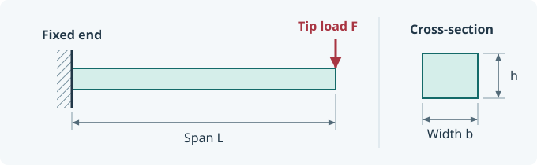

## Cantilever beam tutorial

### The sizing problem

Choose a rectangular section and material for a 500 mm beam fixed at one end. A downward point load acts at the free end. The Bayesian Network represents the cause-effect connection between the variables. The example computes stress at the fixed end, tip deflection and beam mass.

The example uses 512 Latin hypercube samples with a fixed seed. Width and depth range from 10 to 50 mm, while tip load ranges from 50 to 200 N. Each input interval contributes one sample per axis. Material is the fourth sampled input, divided into thirds.

| Material  | Young’s modulus (GPa) | Density (kg/m³) | Allowable bending stress (MPa) |
| --------- | --------------------: | --------------: | -----------------------------: |
| Steel     |                   200 |           7,850 |                             45 |
| Aluminium |                    69 |           2,700 |                             35 |
| Titanium  |                   114 |           4,500 |                             55 |

### Calculations

- Section inertia is `I = bh³ / 12`, where `h` is the vertical section depth.
- Root stress is `σ = FL(h/2) / I`. The simulated design fails when stress exceeds the material’s allowable value.
- Tip deflection is `δ = FL³ / (3EI)` under linear elastic bending.
- Mass is `m = ρbhL / 10⁹` with lengths in mm. A 20 × 20 mm aluminium section has a mass of 0.54 kg.

### Calculate two columns

In **Data → Calculate column**, try `=[Width (mm)] * [Depth (mm)]` for section area and `=AND([Failure] = "Passes", [Beam mass (kg)] < 1)` for the pass flag. The flag is 1 when both requirements hold and 0 when either fails. An unavailable measurement produces a blank result. Preview each column before applying it.

### Find a feasible design space

1. Load the example in **Data**, then choose **Train model** in **States & training**.
2. In **Queries**, select **Design space**. The example sets tip load to 87.50 to below 125.00 N, **Failure** to **Passes**, and beam mass to below 1 kg. Leave width, depth and material unobserved. Run the selected query.
3. In the heatmap, change the **Material** slice and turn on **Show values**. Use **Table** to compare all combinations.
4. Choose **Edit query → Duplicate query**. In the copy, open **Multiple states / numeric threshold** for beam mass and apply a threshold of 2 kg. Run both queries and use the Results selector to compare them.

### Sample and optimise

Open **Sample distribution** from Results to draw candidate inputs. For a surrogate prediction of beam mass, choose width, depth and material as inputs, and beam mass as the output. Review the held-out error before applying predictions.

For optimisation, select the original 1 kg query and choose **Start study from this query**. Review retained regions and set the exact tip load in Setup. Fit the surrogates, search the regions, then inspect the predicted Pareto front and linked parallel coordinates.

A single Bayesian network cell can contain passing and failing designs. Use the beam equations to check exact dimensions before choosing a design.
